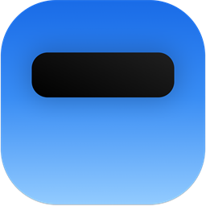
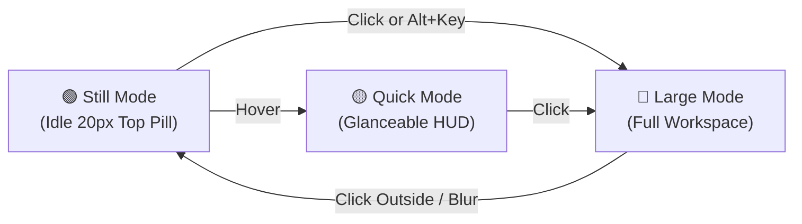

<div align="center">

  

  # Quick Pill
  ### The Next-Generation Dynamic Island for Windows 10 & 11

  <p align="center">
    <strong>A fluid, context-aware notch engineered for power users, creators, and multitaskers.</strong><br />
    Seamless notifications, audio mixer, persistent file shelf, prayer times, instant search, and smart widgets — always at your fingertips, never in your way.
  </p>

  <!-- Primary Download CTA Button (Image 1 Style) -->
  <p align="center">
    <a href="https://pub-ec47b1fa4cbf4c5ba82408a738fb69d3.r2.dev/QuickPill-Windows-v5.6.0-Setup.exe">
      
    </a>
  </p>

  <p align="center">
    <a href="https://quickpill.neosparkx.com/"><strong>🌐 Official Website</strong></a> • 
    <a href="https://github.com/nabil24024004/Quick-Pill-Dynamic-Island-for-Windows/releases"><strong>📦 GitHub Releases</strong></a> • 
    <a href="https://github.com/nabil24024004/Quick-Pill-Dynamic-Island-for-Windows/issues"><strong>🐛 Report Bug</strong></a>
  </p>

  <!-- Status & Action Badges (Image 2 Style - for-the-badge) -->
  <p align="center">
    <a href="https://pub-ec47b1fa4cbf4c5ba82408a738fb69d3.r2.dev/QuickPill-Windows-v5.6.0-Setup.exe"></a>
    <a href="https://github.com/nabil24024004/Quick-Pill-Dynamic-Island-for-Windows/releases"></a>
    <a href="https://github.com/nabil24024004/Quick-Pill-Dynamic-Island-for-Windows/pulls"></a>
    <a href="LICENSE"></a>
  </p>

  <!-- Tech Stack Badges (Image 2 Style - for-the-badge) -->
  <p align="center">
    <a href="https://electronjs.org"></a>
    <a href="https://www.framer.com/motion/"></a>
    <a href="https://learn.microsoft.com/en-us/windows/win32/coreaudio/wasapi"></a>
    
    
  </p>

  <!-- Product Preview Video -->
  https://github.com/user-attachments/assets/bd057d18-f65e-4cf4-bf66-a5d107f18658

</div>

---

## 🌟 What's New in v5.6.0

<table>
  <tr>
    <td width="50%">
      <h3>📁 Drop Shelf (Tab 16 • <code>Alt+F</code>)</h3>
      <p>A persistent session staging stash at the top of your screen. Drop any files or folders from Windows Explorer straight into the notch. Items remain accessible until system restart — drag them out to copy anywhere or click to launch instantly.</p>
    </td>
    <td width="50%">
      <h3>🕌 Prayer Times & Celestial Arc (Tab 17 • <code>Alt+P</code>)</h3>
      <p>Location-synchronized Islamic prayer schedules with offline astronomical calculation fallback. Features a live celestial sun arc, next-prayer hero countdown, and a tranquil collapsed azan notification banner with custom chime.</p>
    </td>
  </tr>
  <tr>
    <td width="50%">
      <h3>⛅ Weather Pod Redesign (Tab 1 • <code>Alt+W</code>)</h3>
      <p>Refined 3D glassmorphic weather cards with dynamic <strong>Day (#FFD801)</strong> and <strong>Night (#061E40)</strong> accent colorways, 7-day extended forecasts, humidity, wind, and sunrise/sunset metrics.</p>
    </td>
    <td width="50%">
      <h3>🔍 Search Command Bar (Tab 0 • <code>Alt+B</code>)</h3>
      <p>Supercharged universal search with Google Red accents, instant query completion, and one-click quick switches for <strong>Google, YouTube, GitHub, ChatGPT, and Claude</strong>.</p>
    </td>
  </tr>
</table>

---

## ⚡ Core Highlights

### 🎛️ Per-App Audio Mixer (Tab 12 • `Alt+A`)
Control audio volume per application directly from the Dynamic Island. Built on native Windows Core Audio (WASAPI) with live audio peak indicators, device selectors, and instant mute toggles.

### 🚀 App Launcher & Workspace Hub (Tab 14 • `Alt+L`)
Search and launch installed Windows applications with authentic system icons. Switch running application windows seamlessly, pin favorites, and trigger multi-app workspace launch profiles with automatic smart-collapse when you're done.

### 📝 Quick Notes & Contextual Capture (Tab 15 • `Alt+Q`)
Floating instant-scratchpad with debounced autosave, crash recovery, tags, and search. Convert any note into a prioritized task with a single click.

### 🔔 Smart Notification Center (Tab 5 • `Alt+N`)
Rich notification hub featuring VoIP incoming call cards (WhatsApp/Slack/Teams), inline quick-replies, smart snooze presets (5m, 15m, 30m, 1h), grouped multi-message stacks, and privacy preview masking.

### 🔋 Apple Liquid Battery Hub (Tab 11)
Dynamic battery telemetry rendered by a 60 FPS fluid liquid wave canvas engine with discharge rate metrics, buoyant micro-bubbles, and remaining endurance estimation.

### 🛡️ Screen-Saver Priority & Ctrl Click-Through
Quick Pill runs at Windows `screen-saver` topmost priority (`setAlwaysOnTop(true, 'screen-saver')`), ensuring it stays visible above full-screen games and apps. Need to click something behind it? **Simply hold `Ctrl`** while hovering to pass mouse clicks directly through the Island!

---

## 🕹️ The Three Interaction Modes



- **🟢 Still Mode** — Minimal semicircular notch resting flush at the screen bezel with near-zero resource consumption.
- **🟡 Quick Mode** — Hover over the notch to view glanceable time, weather, active music track info, or battery status.
- **🔵 Large Mode** — Click or use `Alt + Key` to expand into the full stadium dashboard with tab carousel, detailed metrics, and interactive controls.

---

## ⌨️ Instant Tab Shortcuts (`Alt + <Key>`)

Quick Pill features zero-latency global keyboard navigation. All shortcuts use `Alt + <Key>` to preserve `Ctrl` exclusively for the instant click-through engine.

| Tab | Name | Default Shortcut | Action & Description |
|:---:|:---|:---:|:---|
| **0** | **Browser Search** | `Alt + B` | Quick web search with Google, Claude, ChatGPT, GitHub & YouTube |
| **1** | **Weather Pod** | `Alt + W` | Real-time weather, 7-day forecast & dynamic day/night themes |
| **2** | **Overview** | `Alt + O` | System dashboard with time, date, weather & daily quote |
| **3** | **Now Playing** | `Alt + M` | Live music controls with marquee titles & album art |
| **4** | **Calendar** | `Alt + C` | Interactive monthly calendar with today highlight |
| **5** | **Notifications** | `Alt + N` | Notification center with VoIP cards, snooze & inline replies |
| **6** | **System Stats** | `Alt + G` | Real-time CPU, RAM & system resource telemetry |
| **7** | **Clipboard** | `Alt + V` | Copied text history with one-click copy & deletion |
| **8** | **Tasks** | `Alt + T` | Minimalist Things-style to-do list with circular checkboxes |
| **9** | **Settings** | `Alt + S` | Personalization, tab ordering, themes & update preferences |
| **10** | **Timer** | `Alt + R` | Lock-screen & sleep-persistent countdown timers with sound alarm |
| **12** | **Audio Mixer** | `Alt + A` | WASAPI per-app volume sliders, mute toggles & device selector |
| **14** | **App Launcher** | `Alt + L` | Quick app launcher, window switcher & workspace presets |
| **15** | **Quick Notes** | `Alt + Q` | Markdown notes scratchpad with note-to-task conversion |
| **16** | **Drop Shelf** | `Alt + F` | Persistent drag-and-drop file staging area until PC restart |
| **17** | **Prayer Times** | `Alt + P` | City-synced prayer timings, celestial sun arc & azan chime |

> **Tip:** You can customize or re-record any shortcut in **Settings → Shortcuts**.

---

## 📥 Installation

### Option 1: Automatic Installer (Recommended)
1. Download **[QuickPill-Windows-v5.6.0-Setup.exe](https://pub-ec47b1fa4cbf4c5ba82408a738fb69d3.r2.dev/QuickPill-Windows-v5.6.0-Setup.exe)**.
2. Run the installer. Quick Pill installs silently and automatically launches.
3. Silent auto-updates will keep your installation fresh with zero disruption.

### Option 2: Portable / Manual
Download the unpacked zip or setup from the **[GitHub Releases](https://github.com/nabil24024004/Quick-Pill-Dynamic-Island-for-Windows/releases)** page.

---

## 🛠️ Technology Stack

```
Frontend:     React 19 • Framer Motion 12 • Lucide React • Vite 6
Desktop:      Electron 38 • Node.js 22 • Win32 Shell API
Native Audio: Windows Core Audio (WASAPI) • C# PowerShell Bridge
Packaging:    Electron Forge • Electron Builder • NSIS Installer
Platform:     Windows 10 & 11 (x64)
```

---

## 💻 Local Development

### Prerequisites
- [Node.js](https://nodejs.org/) (v18.0 or newer)
- npm (v9.0 or newer)
- Windows 10 or 11 with PowerShell 5.1+

### Clone & Run

```bash
# Clone the repository
git clone https://github.com/nabil24024004/Quick-Pill-Dynamic-Island-for-Windows.git
cd Quick-Pill-Dynamic-Island-for-Windows

# Install dependencies
npm install

# Start Vite dev server + Electron with hot-reload
npm start
```

### Production Build

```bash
# Run test suite
npm test

# Build Vite renderer, pack services, and generate NSIS installer
npm run build
```

---

## 👥 Authors & Team

Quick Pill is designed and actively developed by **Sheikh Azwad Abrar Nabil ("Abrar")** and the **[NeosparkX](https://github.com/nabil24024004)** team in Bangladesh.

- **Founder & Lead Developer:** [Sheikh Azwad Abrar Nabil](https://github.com/nabil24024004)
- **Agency:** NeosparkX — AI applications, full-stack desktop & web, and intuitive UI/UX design.

---

## 📄 License

Quick Pill is open-source software licensed under the **[MIT License](LICENSE)**.
Feel free to star ⭐ the repository and join us in shaping the desktop experience!
