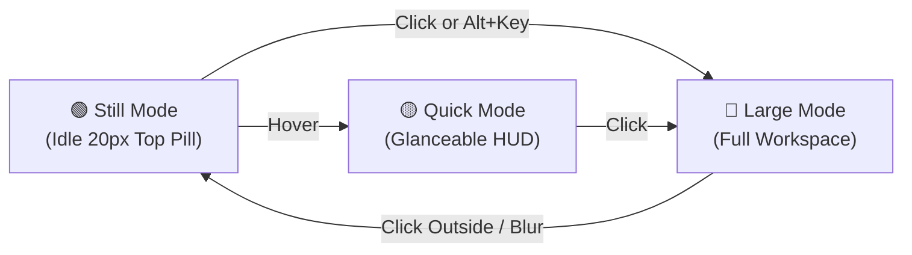

<div align="center">

  

  # Quick Pill
  ### The Next-Generation Dynamic Island for Windows 10 & 11

  <p align="center">
    <strong>A fluid, context-aware notch engineered for power users, creators, and multitaskers.</strong><br />
    Seamless notifications, audio mixer, persistent file shelf, prayer times, instant search, and smart widgets — always at your fingertips, never in your way.
  </p>

  <!-- Primary Download & Microsoft Store CTAs -->
  <p align="center">
    <a href="https://apps.microsoft.com/detail/9N371MQB4BS7?mode=direct">
      <picture>
        <source media="(prefers-color-scheme: dark)" srcset="assets/ms-store-dark.svg" />
        
      </picture>
    </a>
    &nbsp;&nbsp;
    <a href="https://pub-ec47b1fa4cbf4c5ba82408a738fb69d3.r2.dev/QuickPill-Windows-v6.0.0-Setup.exe">
      
    </a>
  </p>

  <p align="center">
    <a href="https://quickpill.neosparkx.com/"><strong>🌐 Official Website</strong></a> • 
    <a href="https://quickpill.neosparkx.com/#/privacy"><strong>🔒 Privacy Policy</strong></a> • 
    <a href="https://github.com/nabil24024004/Quick-Pill/releases"><strong>📦 GitHub Releases</strong></a> • 
    <a href="https://github.com/nabil24024004/Quick-Pill/issues"><strong>🐛 Report Bug</strong></a>
  </p>

  <!-- Status & Action Badges (Image 2 Style - for-the-badge) -->
  <p align="center">
    <a href="https://apps.microsoft.com/detail/9N371MQB4BS7?mode=direct"></a>
    <a href="https://pub-ec47b1fa4cbf4c5ba82408a738fb69d3.r2.dev/QuickPill-Windows-v6.0.0-Setup.exe"></a>
    <a href="https://github.com/nabil24024004/Quick-Pill/releases"></a>
    <a href="https://github.com/nabil24024004/Quick-Pill/pulls"></a>
    <a href="LICENSE"></a>
  </p>

  <!-- Tech Stack Badges (Image 2 Style - for-the-badge) -->
  <p align="center">
    <a href="https://v2.tauri.app/"></a>
    <a href="https://react.dev/"></a>
    <a href="https://learn.microsoft.com/en-us/windows/win32/coreaudio/wasapi"></a>
    
    
  </p>

</div>

---

## 🌟 What's New in v6.0.0

<table>
  <tr>
    <td width="50%">
      <h3>🦀 Native Rust + Tauri v2 Architecture</h3>
      <p>Completely rebuilt from Electron to a lightweight native Rust backend with Microsoft Edge WebView2 — preserving the exact UI while delivering instant startup, lower memory usage, and a fraction of the installer size.</p>
    </td>
    <td width="50%">
      <h3>⚡ Zero-Shell Win32, WinRT &amp; WASAPI</h3>
      <p>Replaces external PowerShell bridges with direct native Rust calls for SMTC media controls, Windows toast notifications, per-app WASAPI audio mixing, topmost overlay bounds, and global <code>Alt+Key</code> shortcuts.</p>
    </td>
  </tr>
  <tr>
    <td width="50%">
      <h3>🔐 Authenticode Signing &amp; SAC Protection</h3>
      <p>Added Windows code-signing pipeline support (<code>sign-windows.ps1</code>) and Smart App Control policy error detection in the in-app updater so blocked launches fail safely with clear recovery guidance.</p>
    </td>
    <td width="50%">
      <h3>📁 Drop Shelf, Prayer Times &amp; Full Suite</h3>
      <p>Full parity across all 16+ tabs including persistent Drop Shelf previews &amp; native drag-out (<code>Alt+F</code>), Prayer Times celestial arc (<code>Alt+P</code>), Weather Pod, Quick Notes, App Launcher, and Audio Mixer.</p>
    </td>
  </tr>
</table>

---

## ⚡ Core Highlights

### 🎛️ Per-App Audio Mixer (Tab 12 • `Alt+A`)
Control audio volume per application directly from the Dynamic Island. Built on native Windows Core Audio (WASAPI) with live audio peak indicators, device selectors, and instant mute toggles.

### 🚀 App Launcher & Workspace Hub (Tab 14 • `Alt+L`)
Search and launch installed Windows applications with authentic system icons. Switch running application windows seamlessly, pin favorites, and trigger multi-app workspace launch profiles with automatic smart-collapse when you're done.

### 📝 Quick Notes & Contextual Capture (Tab 15 • `Alt+Q`)
Floating instant-scratchpad with debounced autosave, crash recovery, tags, and search. Convert any note into a prioritized task with a single click.

### 🔔 Smart Notification Center (Tab 5 • `Alt+N`)
Rich notification hub featuring VoIP incoming call cards (WhatsApp/Slack/Teams), inline quick-replies, smart snooze presets (5m, 15m, 30m, 1h), grouped multi-message stacks, and privacy preview masking.

### 🔋 Apple Liquid Battery Hub (Tab 11)
Dynamic battery telemetry rendered by a 60 FPS fluid liquid wave canvas engine with discharge rate metrics, buoyant micro-bubbles, and remaining endurance estimation.

### 🛡️ Topmost Overlay & Ctrl Click-Through
Quick Pill runs as a native Win32 topmost overlay (`HWND_TOPMOST`), ensuring it stays visible above full-screen games and apps. Need to click something behind it? **Simply hold `Ctrl`** while hovering to pass mouse clicks directly through the Island!

---

## 🕹️ The Three Interaction Modes



- **🟢 Still Mode** — Minimal semicircular notch resting flush at the screen bezel with near-zero resource consumption.
- **🟡 Quick Mode** — Hover over the notch to view glanceable time, weather, active music track info, or battery status.
- **🔵 Large Mode** — Click or use `Alt + Key` to expand into the full stadium dashboard with tab carousel, detailed metrics, and interactive controls.

---

## ⌨️ Instant Tab Shortcuts (`Alt + <Key>`)

Quick Pill features zero-latency global keyboard navigation. All shortcuts use `Alt + <Key>` to preserve `Ctrl` exclusively for the instant click-through engine.

| Tab | Name | Default Shortcut | Action & Description |
|:---:|:---|:---:|:---|
| **0** | **Browser Search** | `Alt + B` | Quick web search with Google, Claude, ChatGPT, GitHub & YouTube |
| **1** | **Weather Pod** | `Alt + W` | Real-time weather, 7-day forecast & dynamic day/night themes |
| **2** | **Overview** | `Alt + O` | System dashboard with time, date, weather & daily quote |
| **3** | **Now Playing** | `Alt + M` | Live music controls with marquee titles & album art |
| **4** | **Calendar** | `Alt + C` | Interactive monthly calendar with today highlight |
| **5** | **Notifications** | `Alt + N` | Notification center with VoIP cards, snooze & inline replies |
| **6** | **System Stats** | `Alt + G` | Real-time CPU, RAM & system resource telemetry |
| **7** | **Clipboard** | `Alt + V` | Copied text history with one-click copy & deletion |
| **8** | **Tasks** | `Alt + T` | Minimalist Things-style to-do list with circular checkboxes |
| **9** | **Settings** | `Alt + S` | Personalization, tab ordering, themes & update preferences |
| **10** | **Timer** | `Alt + R` | Lock-screen & sleep-persistent countdown timers with sound alarm |
| **12** | **Audio Mixer** | `Alt + A` | WASAPI per-app volume sliders, mute toggles & device selector |
| **14** | **App Launcher** | `Alt + L` | Quick app launcher, window switcher & workspace presets |
| **15** | **Quick Notes** | `Alt + Q` | Markdown notes scratchpad with note-to-task conversion |
| **16** | **Drop Shelf** | `Alt + F` | Persistent drag-and-drop file staging area until PC restart |
| **17** | **Prayer Times** | `Alt + P` | City-synced prayer timings, celestial sun arc & azan chime |

> **Tip:** You can customize or re-record any shortcut in **Settings → Shortcuts**.

---

## 📥 Installation

### Option 1: Microsoft Store (Recommended — Smart App Control Ready)
1. Install directly from the **[Microsoft Store (`9N371MQB4BS7`)](https://apps.microsoft.com/detail/9N371MQB4BS7?mode=direct)**.
2. Microsoft Store packages are cryptographically signed by Microsoft, passing Windows 11 **Smart App Control** and SmartScreen cleanly without security prompts.
3. Updates and launch-on-startup are managed natively through Windows & Microsoft Store.

### Option 2: Direct Windows Installer (`.exe`)
1. Download **[QuickPill-Windows-v6.0.0-Setup.exe](https://pub-ec47b1fa4cbf4c5ba82408a738fb69d3.r2.dev/QuickPill-Windows-v6.0.0-Setup.exe)**.
2. Run the installer. Quick Pill installs silently per-user and automatically launches.
3. Built-in auto-updates keep your installation fresh with SHA-256 verification.

### Option 3: GitHub Releases
Download installers from the **[GitHub Releases](https://github.com/nabil24024004/Quick-Pill/releases)** page.

> **Note on Windows SmartScreen & Smart App Control:** Installers from Microsoft Store (`.msix`) are automatically trusted by Windows 11 Smart App Control. For direct `.exe` distribution, maintainers can also configure CI signing secrets via `scripts/sign-windows.ps1` (PFX, Cert Store thumbprints, or Azure Trusted Signing).

---

## 🛠️ Technology Stack

```
Frontend:     React 19 • Framer Motion 12 • Lucide React • Vite 5
Desktop:      Tauri v2 • Rust Native Backend • Microsoft Edge WebView2
Native APIs:  Win32 Shell & Overlay • WinRT (SMTC, Toasts, UWP) • WASAPI Audio
Packaging:    Tauri Bundler • NSIS Installer • Authenticode Hook Support
Platform:     Windows 10 & 11 (x64)
```

---

## 💻 Local Development

### Prerequisites
- [Node.js](https://nodejs.org/) (v18.0 or newer) & `npm`
- [Rust toolchain](https://rustup.rs/) (`stable` + `cargo`)
- Microsoft Edge WebView2 Runtime & Visual Studio C++ Build Tools
- Windows 10 or 11 (x64)

### Clone & Run

```bash
# Clone the repository
git clone https://github.com/nabil24024004/Quick-Pill.git
cd Quick-Pill

# Install dependencies
npm install

# Start Vite dev server + Tauri v2 with hot-reload
npm start
```

### Production Build & Manifest

```bash
# Run Rust test suite
npm test

# Build Vite frontend, Rust binary, and NSIS installer (with optional signing hook)
npm run build

# Package Microsoft Store MSIX (uses src-tauri/msix/store.config.json)
npm run build:msix

# Update web app/public/version.json with installer size, SHA-256 & Store metadata
npm run generate-manifest
```

---

## 👥 Authors & Team

Quick Pill is designed and actively developed by **Sheikh Azwad Abrar Nabil ("Abrar")** and the **[NeosparkX](https://github.com/nabil24024004)** team in Bangladesh.

- **Founder & Lead Developer:** [Sheikh Azwad Abrar Nabil](https://github.com/nabil24024004)
- **Agency:** NeosparkX — AI applications, full-stack desktop & web, and intuitive UI/UX design.

---

## 📄 License

Quick Pill is open-source software licensed under the **[MIT License](LICENSE)**.
Feel free to star ⭐ the repository and join us in shaping the desktop experience!
